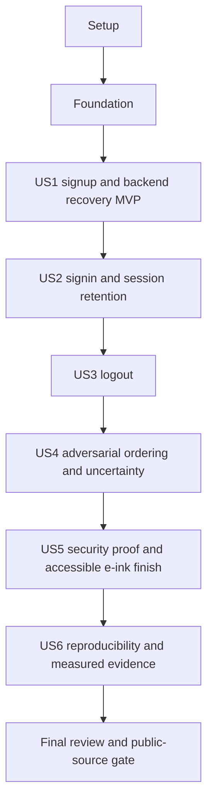

# Tasks: Secure User Authentication

**Input**: `specs/001-user-auth/` — [plan](plan.md), [specification](spec.md), [binding contract](implementation-contract.md), [research](research.md), [data model](data-model.md), [interface contracts](contracts/http-api.md), [verification map](verification.md), [quickstart](quickstart.md).
**Created**: 2026-10-15 | **Branch**: `master` (unchanged)
**Status**: Phase 1 setup is in progress. Checked tasks have passed their exact listed checks; remaining tasks are unexecuted. No authentication behavior, application build, benchmark or publication is claimed here.
**Tests**: Mandatory under C08/C10 and FR-031. Behavioral tests precede implementation; integration regressions that already pass are recorded honestly rather than forced to fail.
**Organization**: Shared setup/foundation, then US1–US6 in specification priority order, then final delivery gates. No constitution or extensions.yml hooks are present.

## Format and execution rules

- Every task uses `- [ ] TNNN [P?] [USn?]` plus exact owned file paths. Setup/foundation/final phases have no story label. Story phases always have their matching label.
- Each code change is budgeted at 2–5 minutes of focused work, at most **2 owned source/test/config files**, and at most **100 added production lines in total**. Tests/generated build outputs do not count as production lines. Split a task before implementation if actual scope exceeds its cap; preserve dependency/coverage references.
- `[P]` is conditional on the listed prerequisite IDs and the phase barrier being complete. Only the documented same-cohort tasks with disjoint owned files are candidates. Shared-file controller/service edits and root build/release commands are serialized.
- Test-writing tasks record the intended RED assertion. Unit/pair tasks turn it GREEN directly. A small model/service assembly task may leave its already-written HTTP target RED until the explicitly named route-closure task; it must pass its compile check and must not claim that HTTP behavior passed. Story checkpoints require all targets GREEN before leaving that increment. This is integration-test-first assembly, not a production-ready intermediate release.
- For every task, run its exact check below and record the observed result. Syntax/import/environment errors unrelated to the intended missing contract are not valid behavior evidence. Never silence compiler/test failures to manufacture GREEN.
- Inspect the change, then commit the owned files at a GREEN task or coherent RED→GREEN checkpoint using `git add -- <the task's explicit owned paths>` and `git commit -m 'TNNN: <task description>'`. Do not stage unrelated/preexisting files, bypass hooks, force-push, or publish an intentionally incomplete security checkpoint.
- Root path references are project-relative. Use the current feature metadata, never infer a feature directory from the Git branch.

## Fixed interfaces and runtime rules

All implementation inherits C01–C14 without restating or relaxing them per task. Exact protocol/state details live in [HTTP](contracts/http-api.md), [sessions](contracts/session-lifecycle.md), [client](contracts/client-auth.md), and [deployment](contracts/deployment.md).

- Shared package: `canonicalizePassword(raw:string):string`, `codePointLength(value:string):number`, `signupPasswordIssues(raw:string):string[]`, `signinPasswordIssues(raw:string):string[]`; `SignupSchema`, `SigninSchema`, `PublicUserSchema`, `ApiErrorSchema`; inferred `SignupInput`, `SigninInput`, `PublicUser`, `ApiError`. Canonical inputs contain NFC password, lowercased/trimmed email and trimmed name; no other password transformation.
- `HashWork.run<T>(work:()=>Promise<T>):Promise<T>` owns 2 active / 4 waiting / 1000-ms admission. `PasswordService.hash(canonicalPassword:string):Promise<string>` and `verify(storedHash:string,canonicalPassword:string):Promise<boolean>` share it. Dummy verification is precomputed and admitted identically.
- `SessionPolicy` computes/validates deadlines from `{userId,authenticatedAt,lastActivityAt}` using an injected wall clock. SessionService exposes `establish(req,res,userId):Promise<void>`, `requireSession(req,res):string`, `renew(req,res):Promise<void>`, `destroy(req,res):Promise<void>`. No response success precedes required persistence/destruction.
- `AuthService.signup(input:SignupInput):Promise<PublicUser>`, `signin(input:SigninInput):Promise<PublicUser>` and `getPublicUser(userId:string):Promise<PublicUser>` do account/hash work; controllers own session orchestration. Mongoose model is used directly, not an extra repository hierarchy.
- `buildApp(options):Promise<NestExpressApplication>` accepts validated config and test-only injected clocks/store callbacks/route policies/assets directory through its factory, never through insecure production env toggles. Fixtures expose app, request agent, owned database/client/store, auth headers, controlled clock and teardown. No globals survive fixtures.
- Client uses the methods/snapshot in contracts/client-auth.md, one controller per tab, relative fetch and HttpOnly cookie. Match intended user before success; stale read/error/finally cannot apply; logout receipt differs from anonymous observation.

## Script interface established by setup

These are required commands to implement, not commands already available or executed:

| Root command | Meaning |
| --- | --- |
| `build:shared`, `build:api`, `build:web`, `build` | tsc shared ESM/declarations, tsc metadata-emitting API, Vite SPA; aggregate builds in shared→API→web order |
| `build:test:api [test-path]` | Standard-library `scripts/build-api-test.mjs` invokes selected tsc. No argument compiles full API suite to `apps/api/dist-test/test/`; a validated `apps/api/test/<suite>.ts` isolates transitive compilation under `apps/api/dist-test/targets/<suite>/test/`. Preserve NodeNext/decorators/types, disable shared incremental cache, clean only owned temporary config, and propagate failure. Do not rebuild shared concurrently; ensure `build:shared` before cohorts that consume it. |
| `test:unit:api` | Build shared and full API tests, run Node primitive/unit files, excluding `.integration.test.js` |
| `test:unit` | Shared/web Vitest and API unit tests; workspace `test:unit` scripts use `vitest run --config ../../vitest.config.ts --project shared` or `--project web`, matching the root projects |
| `test:integration` | Build shared/full API tests and run every `.integration.test.js` against real isolated Mongo; missing DB fails |
| `typecheck`, `lint` | Full strict workspace/source/test checking and ESLint; no transpile-only substitute |
| `test:e2e` | Build then run pinned Playwright core/Unicode/accessibility suites; missing browsers/DB fail |
| `verify` | Lint, typecheck, production build, unit, real integration and browser suites; any required failure/nonexecution fails aggregate |
| `db:up`, `dev:api`, `dev:web`, `start` | Healthy local Mongo; compiled API with local env; Vite preserving Origin; production compiled API/static assets |
| `benchmark:hash` | Compiled `apps/api/dist/benchmark-hash.js`; reports actual samples/RSS/runtime and accepts `--stdout` in the runtime image |

Playwright webServer runs the built same-origin app with explicit test origin/port, generated valid secret and isolated Mongo URI; it uses the same security policy. Test-only Unicode HTML/module routes are confined to browser-test tooling and excluded from production serving. Full and focused API compilation must preserve decorator metadata; no loader that silently strips it is acceptable.

## Phase 1: Setup (Shared Infrastructure)

**Goal**: Establish the pinned toolchain, build/test script interfaces, exact dependencies, local Mongo and honest AI log.

**Independent validation**: Configuration and package installation checks work before source exists; no authentication behavior is claimed.

- [x] T001 Pin Node 24.22.0 and npm 11.19.1 with engine-strict/exact-save settings in `.nvmrc` and `.npmrc`.
  After: none (start here). Check: **K001**. Coverage: plan setup/prerequisite.
  Expected: Exact selected runtime is available; do not silently use the workstation Node 22.

- [x] T002 Declare private ESM workspaces and the root script interface defined below in `package.json`.
  After: T001. Check: **K002**. Coverage: plan setup/prerequisite.
  Expected: Three named workspaces; pinned engines; root commands match the script contract.

- [x] T003 [P] Configure browser-safe ESM/declaration exports and strict shared compilation in `packages/auth-contract/package.json` and `packages/auth-contract/tsconfig.json`.
  After: T002. Check: **K003**. Coverage: plan setup/prerequisite.
  Expected: Built exports target dist; no source aliases or Node-only runtime imports.

- [ ] T004 [P] Pin Nest/Mongoose/session/Argon2 dependencies and NodeNext metadata-emitting API compilation in `apps/api/package.json` and `apps/api/tsconfig.json`.
  After: T002. Check: **K004**. Coverage: plan setup/prerequisite.
  Expected: Versions match research.md; explicit mongodb peer; ESM and decorator metadata enabled.

- [ ] T005 [P] Pin React/router/Vite/test dependencies and bundler-resolution frontend compilation in `apps/web/package.json` and `apps/web/tsconfig.json`.
  After: T002. Check: **K005**. Coverage: plan setup/prerequisite.
  Expected: Versions match research.md; strict TypeScript and React JSX configured.

- [ ] T006 Define strict shared compiler options and typed ESLint rules without type-error suppression in `tsconfig.base.json` and `eslint.config.js`.
  After: T003, T004, T005. Check: **K006**. Coverage: plan setup/prerequisite.
  Expected: API includes strictness/decorator metadata; lint excludes generated/vendor outputs only.

- [ ] T007 [P] Configure compiled Node backend tests and Vitest shared/web projects with jsdom for forms in `apps/api/tsconfig.test.json` and `vitest.config.ts`.
  After: T006. Check: **K007**. Coverage: plan setup/prerequisite.
  Expected: API src/test output under dist-test; no SWC/esbuild path losing Nest metadata.

- [ ] T008 Add target-aware tsc test compilation using a temporary config; no-argument mode compiles the full API suite in `scripts/build-api-test.mjs`.
  After: T007. Check: **K008**. Coverage: plan setup/prerequisite.
  Expected: Optional test path compiles only that entry/transitive sources/session declarations into dist-test/targets/<suite>; disable shared incremental cache, propagate errors, preserve metadata, remove owned temp config. No-argument full mode uses dist-test/test.

- [ ] T009 [P] Configure Vite root and localhost /api proxy retaining Origin; add HTML entry in `apps/web/vite.config.ts` and `apps/web/index.html`.
  After: T006. Check: **K009**. Coverage: plan setup/prerequisite.
  Expected: Vite targets 127.0.0.1:3000 without origin rewriting; entry points at src/main.tsx.

- [x] T010 [P] Document required environment with no usable secret and exclude secrets/cookies/generated outputs in `.env.example` and `.gitignore`.
  After: T002. Check: **K010**. Coverage: FR-016, FR-026.
  Expected: Local origin/URI are explicit; no test bypass or production fallback secret.

- [x] T011 [P] Add digest-pinned local Mongo 8.0 with health check, owned volume and loopback-only port in `compose.yaml`.
  After: T002. Check: **K011**. Coverage: FR-016, FR-033.
  Expected: Only Mongo infrastructure; no Redis; published 27017 binds 127.0.0.1.

- [ ] T012 Resolve compatible auxiliary type/lint packages under selected peers and commit one exact dependency graph in `package-lock.json`.
  After: T007, T009, T010, T011, T008. Check: **K012**. Coverage: plan setup/prerequisite.
  Expected: No peer overrides, legacy-peer-deps or duplicate workspace lockfiles; native Argon2 installs on selected runtime.

- [ ] T013 [P] Configure built-app Playwright webServer and Chromium/Firefox/WebKit projects with isolated test data in `playwright.config.ts`.
  After: T012. Check: **K013**. Coverage: plan setup/prerequisite.
  Expected: Pinned runner resolves; mandatory browsers/DB failures will fail rather than skip suites.

- [ ] T014 [P] Record actual specification/planning/task AI assistance and source-research corrections so far in `AI.md`.
  After: T012. Check: **K014**. Coverage: FR-030, V20.
  Expected: Factual prompts/decisions; no implementation, test, publication or benchmark success invented; diff exit 1 means new content.


**Checkpoint**: Record this phase’s observed results after T014; an unchecked or failing mandatory target is not delivery evidence.

## Phase 2: Foundational (Blocking Prerequisites)

**Goal**: Prove shared input rules, bounded hashing, deadlines/store boundaries, safe middleware, real-Mongo fixtures and runnable server/static shell.

**Independent validation**: Shared/native/queue/session primitive tests pass; actual fixture prerequisites fail loudly when missing. Complete all foundation work before story features.

**Barrier**: All Phase 1 setup is complete. No story feature begins until all Phase 2 work is complete.
- [ ] T015 Write Unicode/NFC boundary fixtures and failing password tests in `packages/auth-contract/test/unicode-cases.ts` and `packages/auth-contract/test/password.test.ts`.
  After: T013, T014. Check: **K015**. Coverage: FR-004, FR-005, FR-006, V12.
  Expected: Required examples plus 7/8/128/129 post-NFC code points, all forbidden categories, paired/lone surrogates, combining marks and signin-only rules are asserted.
  RED/behavior target: Password helpers are absent or violate a named fixture.

- [ ] T016 Implement pure canonicalizePassword, codePointLength, signupPasswordIssues and signinPasswordIssues in `packages/auth-contract/src/password.ts`.
  After: T015. Check: **K016**. Coverage: FR-004, FR-005, FR-006, V12.
  Expected: NFC only; L/Nd/P-or-S predicates; Cc/Cf/Cs/Zl/Zp rejected at signup; no password trimming or signup composition on signin.
  RED/behavior target: T015.

- [ ] T017 [P] Write strict request/public-user/error schema tests including canonical email/name limits in `packages/auth-contract/test/schemas.test.ts`.
  After: T016. Check: **K017**. Coverage: FR-002, FR-003, FR-005, FR-007, FR-029, V02, V12.
  Expected: Trim/lower email, no Gmail rewrite, 254 limit; trimmed names 3–80 code points; unknown/wrong fields fail; signin password policy stays distinct.
  RED/behavior target: Canonical schema contracts are missing or accept a specified invalid input.

- [ ] T018 [P] Write failing startup/origin/secret/proxy configuration tests in `apps/api/test/config.test.ts`.
  After: T016. Check: **K018**. Coverage: FR-016, V17.
  Expected: Missing/weak base64 secret, noncanonical origin, production HTTP, invalid URI/port and broad proxy trust reject; development remains usable.
  RED/behavior target: Unsafe config is accepted or validation entry point is absent.

- [ ] T019 [P] Write deterministic shared-capacity FIFO, saturation and deadline tests in `apps/api/test/hash-work.test.ts`.
  After: T016. Check: **K019**. Coverage: FR-018, V13.
  Expected: 2 active +4 waiting; seventh rejects; 1000-ms timer/dequeue exhaustion; no timed-out execution; release after resolve/reject and teardown.
  RED/behavior target: Admission counts/wait bounds are not enforced.

- [ ] T020 [P] Implement SignupSchema, SigninSchema, PublicUserSchema and ApiErrorSchema using shared password helpers in `packages/auth-contract/src/schemas.ts`.
  After: T017. Check: **K020**. Coverage: FR-002, FR-003, FR-004, FR-005, FR-006, FR-029, V02, V12.
  Expected: Strict schemas return canonical inputs; safe validation messages never contain credential values.
  RED/behavior target: T017.

- [ ] T021 [P] Implement parsed immutable configuration with the exact development/production policy in `apps/api/src/config.ts`.
  After: T018. Check: **K021**. Coverage: FR-016, V17.
  Expected: No required-secret/origin fallback or environment test bypass; explicit trusted address list and private bind assumptions.
  RED/behavior target: T018.

- [ ] T022 [P] Implement per-app HashWork.run with bounded FIFO and monotonic deadlines in `apps/api/src/security/hash-work.ts`.
  After: T019. Check: **K022**. Coverage: FR-018, V13.
  Expected: Jobs enter only with a slot; timer/dequeue races cannot exceed limits; finally releases and close rejects waiting jobs.
  RED/behavior target: T019.

- [ ] T023 Export inferred DTOs and pure validation entry points through the shared package in `packages/auth-contract/src/types.ts` and `packages/auth-contract/src/index.ts`.
  After: T020, T021, T022. Check: **K023**. Coverage: FR-006, V12.
  Expected: Consumers import @easygen/auth-contract built exports; PublicUser, SignupInput, SigninInput and ApiError names match contracts.

- [ ] T024 [P] Write native Argon2 parameter, verification, dummy-work and common-admission tests in `apps/api/test/password.service.test.ts`.
  After: T023. Check: **K024**. Coverage: FR-009, FR-018, V04, V13.
  Expected: Encoded Argon2id uses m=19456,t=2,p=1; real/dummy verify use the same gate; no per-request dummy hash.
  RED/behavior target: Hash service/default parameter behavior does not meet the selected policy.

- [ ] T025 [P] Write exact idle/absolute deadline tests in `apps/api/test/session-policy.test.ts`.
  After: T023. Check: **K025**. Coverage: FR-009, FR-010, V06, V17.
  Expected: Equality expires; malformed/future-inconsistent metadata rejects; idle renewal never changes authentication time.
  RED/behavior target: Deadline or pinned-cookie policy is absent or extends a boundary.

- [ ] T026 [P] Write adapter delegation, recognized error, no-touch and successful-receipt tests in `apps/api/test/session-store.test.ts`.
  After: T023. Check: **K026**. Coverage: FR-013, V16, V17.
  Expected: get/set/destroy delegate; no touch method; failed set never receipts; changed SID/object/snapshot delegates; identical acknowledged object write is local.
  RED/behavior target: The store boundary fails to preserve pre-response failure semantics.

- [ ] T027 [P] Implement Argon2 hash/verify service and one precomputed dummy verifier through HashWork in `apps/api/src/security/password.service.ts`.
  After: T024. Check: **K027**. Coverage: FR-009, FR-018, V04, V13.
  Expected: 32-byte output, library random salt, argon2.verify stored parameters; bounded work covers all verification.
  RED/behavior target: T024.

- [ ] T028 [P] Implement pure SessionPolicy with injected wall-clock and minimal typed auth metadata in `apps/api/src/session/policy.ts` and `apps/api/src/types/express-session.d.ts`.
  After: T025. Check: **K028**. Coverage: FR-009, FR-010, V06.
  Expected: idle=lastActivity+1800000; absolute=authenticatedAt+28800000; deny equality, no authentication timestamp renewal.
  RED/behavior target: Tests in this task fail for cookie flags/serialization/deadlines before implementation.

- [ ] T029 [P] Implement typed MongoStore delegation and recognized outage branding without touch in `apps/api/src/session/store.ts`.
  After: T026. Check: **K029**. Coverage: FR-013, V16, V17.
  Expected: Store callback outages are typed; unexpected bugs stay sanitized 500; underlying error events handled, no memory fallback.
  RED/behavior target: T026.

- [ ] T030 [P] Write failing cookie tests then implement secure/development options and nonenumerable pinned touch in `apps/api/test/session-cookie.test.ts` and `apps/api/src/session/cookie.ts`.
  After: T028. Check: **K030**. Coverage: FR-009, FR-010, FR-016, V17.
  Expected: Required flags/names; Path=/ no Domain; expiry pinned to minimum deadline; clear options omit lifetime fields.
  RED/behavior target: Tests in this task fail for cookie flags/serialization/deadlines before implementation.

- [ ] T031 [P] Add weak same-object/sid/snapshot-digest receipts after acknowledged saves only in `apps/api/src/session/store.ts`.
  After: T029. Check: **K031**. Coverage: FR-009, FR-013, V16.
  Expected: No duplicate regenerated-session database write; changed content/SID always persists; no raw cookie/HTTP response retry cache.
  RED/behavior target: T026.

- [ ] T032 Assemble reusable buildApp, one Mongoose-owned client and per-app providers with startup readiness in `apps/api/src/app.module.ts` and `apps/api/src/bootstrap.ts`.
  After: T027, T030, T031. Check: **K032**. Coverage: FR-013, FR-016, V17.
  Expected: No module globals; bounded pool; MongoStore collectionP awaited; test dependencies injectable through factory only; route registration comes in story tasks.

- [ ] T033 Create isolated real-Mongo app fixture and safe test database teardown in `apps/api/test/support/fixture.ts`.
  After: T032. Check: **K033**. Coverage: plan setup/prerequisite.
  Expected: Fresh app/limiter/hash gate, controllable policy clock/store callbacks; missing DB fails; cleanup only owned test databases; close shared client once.

- [ ] T034 Write failing sanitized error/no-store tests then implement shared API error mapping in `apps/api/test/api-error.test.ts` and `apps/api/src/common/api-error.filter.ts`.
  After: T033. Check: **K034**. Coverage: FR-007, FR-013, FR-029, V02, V17.
  Expected: Required 400/401/403/409/429/503 and unexpected 500 shapes; no values/hash/cookie/URI/stack; generated request IDs; no-store on failures.
  RED/behavior target: Tests in this task fail for unsafe/missing error behavior before implementation.

- [ ] T035 [P] Write failing origin/request-shape tests then implement exact POST middleware in `apps/api/test/security-primitives.test.ts` and `apps/api/src/security/origin.middleware.ts`.
  After: T033, T034. Check: **K035**. Coverage: FR-015, FR-016, FR-029, V08.
  Expected: Origin exact; trusted Referer only when Origin absent; null/list/malformed rejected; AJAX value exact; expected JSON incl charset; invalid media 400.
  RED/behavior target: Tests in this task fail for unmet origin/header/media behavior before implementation.

- [ ] T036 [P] Write failing throttle tracker/status/unit tests then implement default-policy guard in `apps/api/test/rate-limit.test.ts` and `apps/api/src/security/rate-limit.guard.ts`.
  After: T033, T034. Check: **K036**. Coverage: FR-017, FR-029, V09, V17.
  Expected: Use req.ip and route policies, ms input/sec Retry-After output, standard 429 envelope; no global singleton storage.
  RED/behavior target: Tests in this task fail for the policy/units boundary before implementation.

- [ ] T037 Write failing raw-store-read/anonymous-session tests then implement session loading boundary in `apps/api/test/session-middleware.test.ts` and `apps/api/src/session/session.middleware.ts`.
  After: T035, T036, T034. Check: **K037**. Coverage: FR-009, FR-010, FR-013, FR-015, V16, V17.
  Expected: Required session options; pin after loading; get outage maps before Nest routes; anonymous/rejected requests do not persist or renew; no auto failure fallback.
  RED/behavior target: Tests in this task fail for raw middleware load/pin/failure handling before implementation.

- [ ] T038 Bind origin-before-session, throttle-before-work, filter/Helmet and scoped session providers in `apps/api/src/bootstrap.ts` and `apps/api/src/app.module.ts`.
  After: T037. Check: **K038**. Coverage: FR-013, FR-015, FR-016, FR-017, FR-029, V08, V09, V17.
  Expected: Disable default body parser; register16KiB JSON parsing with safe raw-error-to400 mapping; origin before session, throttle before password work, scoped sessions, no broad CORS; foundation tests pass.
  RED/behavior target: T035.

- [ ] T039 Expose compiled runtime startup/private bind and owned shutdown for the real browser server in `apps/api/src/main.ts`.
  After: T038. Check: **K039**. Coverage: FR-010, FR-013, FR-016, V11, V15, V17.
  Expected: Compiled validated startup/private bind and owned shutdown exist before signup; config tests are already green; no feature claim from build alone.

- [ ] T040 Write failing SPA/API routing assertions then wire built-static serving through Nest Express APIs in `apps/api/test/static.integration.test.ts` and `apps/api/src/bootstrap.ts`.
  After: T039. Check: **K040**. Coverage: FR-016, FR-030, V11, V17.
  Expected: Helmet before assets; non-API GET fallback; API unknown JSON404; fixture supplies temporary assets; production fails if required build absent; no Vite server in production.
  RED/behavior target: Tests in this task fail for missing static/API fallback policy before implementation.


**Checkpoint**: Record this phase’s observed results after T040; an unchecked or failing mandatory target is not delivery evidence.

## Phase 3: User Story 1 — Create an account and enter the application (Priority: P1) — Internal MVP

**Goal**: Create one account, establish a persisted session and enter a verified welcome page; normal backend signin supports partial-failure recovery and NFC acceptance.

**Independent validation**: Fresh valid signup reaches exact welcome text; invalid input creates no user; four duplicate races create one user; save failure keeps account; normal signin recovers and canonical equivalents authenticate.

**Order**: Named contract/behavior tests are written first; focused models/services/controllers/UI follow; final checkpoint records actual results.

### Tests first

- [ ] T041 [P] [US1] Write signup HTTP assertions for canonical inputs, persistence, invalid requests, unique-index concurrency, NFC signin recovery and duplicate 409 in `apps/api/test/auth.integration.test.ts`.
  After: T040. Check: **K041**. Coverage: FR-001, FR-002, FR-003, FR-004, FR-005, FR-006, FR-007, FR-014, V01, V02, V03, V12, V16.
  Expected: Four simultaneous normalized-email requests yield one user/201 and three 409; canonical-equivalent signin and partial-signup recovery use the normal signin route.
  RED/behavior target: HTTP routes are absent or fail the named signup/recovery assertions.

- [ ] T042 [P] [US1] Write delayed-save, regenerated-ID, failed-save-detach and no-response-end-write assertions in `apps/api/test/session.integration.test.ts`.
  After: T040. Check: **K042**. Coverage: FR-009, FR-013, FR-014, V16.
  Expected: No success before release of save callback; failed save returns 503 with no authenticated cookie; account remains; delegated write counts prove receipt behavior.
  RED/behavior target: Authentication establishment is absent or commits/retries at response end.

- [ ] T043 [P] [US1] Write same-origin JSON/header/no-retry/error-body tests for the client transport in `apps/web/test/auth-api.test.ts`.
  After: T040. Check: **K043**. Coverage: FR-015, FR-019, FR-026, FR-029, V14.
  Expected: Relative URLs/credentials same-origin; AJAX and JSON headers; no POST retry; malformed success/network failure remain distinguishable from 401.
  RED/behavior target: Auth transport is absent or conflates failures with successful auth.

- [ ] T044 [P] [US1] Write bootstrap/signup confirmation tests and reusable deferred fake transport helpers in `apps/web/test/auth-controller.test.ts` and `apps/web/test/support/deferred.ts`.
  After: T040. Check: **K044**. Coverage: FR-008, FR-019, FR-020, FR-021, FR-023, FR-024, FR-026, V10, V14.
  Expected: Initial unknown; bootstrap401 anonymous; duplicate submit sends one POST; intended-user confirmation required; failed reconciliation unknown; no password retained in snapshots.
  RED/behavior target: Stable auth controller/signup path is absent or reports false confirmation.

- [ ] T045 [P] [US1] Write minimal semantic signup and protected-render tests in `apps/web/test/forms.test.tsx`.
  After: T040. Check: **K045**. Coverage: FR-001, FR-008, FR-027, V01, V18.
  Expected: Email/name/password labels, shared errors, submit lock, exact welcome copy and no content before verified identity.
  RED/behavior target: Signup/welcome/route components are absent or violate required interactions.


### Implementation and integration

- [ ] T046 [US1] Define minimal user schema/unique email index and await explicit createIndexes at startup in `apps/api/src/auth/user.schema.ts` and `apps/api/src/bootstrap.ts`.
  After: T041, T042. Check: **K046**. Coverage: FR-002, FR-009, V03, V17.
  Expected: passwordHash select:false; timestamps; startup fails on duplicate/index failure; no check-then-insert or syncIndexes. Compilation must pass; its HTTP target remains RED until the named route-closure task, never reported as passing early.
  RED/behavior target: T041.
  HTTP GREEN closure: **T051**. Its HTTP command is `npm run build:test:api -- apps/api/test/auth.integration.test.ts && node --test --test-name-pattern='signup: unique index' apps/api/dist-test/targets/auth.integration.test/test/auth.integration.test.js`; it is not a passing assertion at this assembly step.

- [ ] T047 [US1] Implement AuthService.signup using admitted hashing and one indexed insert with typed 11000 mapping in `apps/api/src/auth/auth.service.ts`.
  After: T046. Check: **K047**. Coverage: FR-001, FR-002, FR-007, FR-009, V01, V03.
  Expected: Canonical account stored once; hash only, public DTO only; code11000 maps409 and recognized database outage503. Compilation must pass; its HTTP target remains RED until the named route-closure task, never reported as passing early.
  RED/behavior target: T041.
  HTTP GREEN closure: **T051**. Its HTTP command is `npm run build:test:api -- apps/api/test/auth.integration.test.ts && node --test --test-name-pattern='signup: canonical account' apps/api/dist-test/targets/auth.integration.test/test/auth.integration.test.js`; it is not a passing assertion at this assembly step.

- [ ] T048 [US1] Implement schema-bound request pipe with field-only safe 400 errors in `apps/api/src/auth/validation.pipe.ts`.
  After: T047. Check: **K048**. Coverage: FR-002, FR-003, FR-004, FR-005, FR-006, FR-029, V02, V12.
  Expected: Shared canonical result reaches services; reject unknown/wrong fields; backend never relies on browser validation. Compilation must pass; its HTTP target remains RED until the named route-closure task, never reported as passing early.
  RED/behavior target: T041.
  HTTP GREEN closure: **T051**. Its HTTP command is `npm run build:test:api -- apps/api/test/auth.integration.test.ts && node --test --test-name-pattern='signup: invalid' apps/api/dist-test/targets/auth.integration.test/test/auth.integration.test.js`; it is not a passing assertion at this assembly step.

- [ ] T049 [US1] Implement SessionService.establish with regenerate, pin, minimal metadata and awaited save in `apps/api/src/session/session.service.ts`.
  After: T048. Check: **K049**. Coverage: FR-009, FR-013, FR-014, V16.
  Expected: Reinstall pinned-touch after regeneration; detach before error response; no mutation after acknowledged commit; account insertion is not rolled back. Compilation must pass; its HTTP target remains RED until the named route-closure task, never reported as passing early.
  RED/behavior target: T042.
  HTTP GREEN closure: **T051**. Its HTTP command is `npm run build:test:api -- apps/api/test/session.integration.test.ts && node --test --test-name-pattern='establish:' apps/api/dist-test/targets/session.integration.test/test/session.integration.test.js`; it is not a passing assertion at this assembly step.

- [ ] T050 [US1] Implement requireSession validation/expiry clearing and default-protected SessionGuard with Public metadata in `apps/api/src/session/session.service.ts` and `apps/api/src/session/session.guard.ts`.
  After: T049. Check: **K050**. Coverage: FR-008, FR-010, FR-013, V05, V06.
  Expected: Only explicit signup/signin are public; malformed/expired sessions detach/clear and return401 without storage cleanup dependency or renewal. Compilation must pass; its HTTP target remains RED until the named route-closure task, never reported as passing early.
  RED/behavior target: T041.
  HTTP GREEN closure: **T054**. Its HTTP command is `npm run build:test:api -- apps/api/test/auth.integration.test.ts && node --test --test-name-pattern='signup: protected identity' apps/api/dist-test/targets/auth.integration.test/test/auth.integration.test.js`; it is not a passing assertion at this assembly step.

- [ ] T051 [US1] Register signup orchestration and global guard order with explicit signup throttling in `apps/api/src/auth/auth.controller.ts` and `apps/api/src/app.module.ts`.
  After: T050. Check: **K051**. Coverage: FR-001, FR-009, FR-014, FR-015, FR-017, V01, V09, V16.
  Expected: POST signup public+origin/validation/throttle; 5/15min; insert then establish before201; expose no session internals.
  RED/behavior target: T041.

- [ ] T052 [US1] Add AuthService.getPublicUser for session-bound identity lookup in `apps/api/src/auth/auth.service.ts`.
  After: T051. Check: **K052**. Coverage: FR-008, FR-009, V05.
  Expected: DTO excludes hash; missing account denies authentication rather than fabricating identity. Compilation must pass; its HTTP target remains RED until the named route-closure task, never reported as passing early.
  RED/behavior target: T041.
  HTTP GREEN closure: **T054**. Its HTTP command is `npm run build:test:api -- apps/api/test/auth.integration.test.ts && node --test --test-name-pattern='signup: protected identity' apps/api/dist-test/targets/auth.integration.test/test/auth.integration.test.js`; it is not a passing assertion at this assembly step.

- [ ] T053 [US1] Add explicit accepted-request renewal with pinned store/cookie deadline and post-I/O expiry recheck in `apps/api/src/session/session.service.ts`.
  After: T052. Check: **K053**. Coverage: FR-009, FR-010, FR-013, V06, V16, V17.
  Expected: Only accepted active session renews; authenticatedAt fixed; await save before protected response; crossed absolute deadline denies. Compilation must pass; its HTTP target remains RED until the named route-closure task, never reported as passing early.
  RED/behavior target: T042.
  HTTP GREEN closure: **T054**. Its HTTP command is `npm run build:test:api -- apps/api/test/session.integration.test.ts && node --test --test-name-pattern='establish: renewal' apps/api/dist-test/targets/session.integration.test/test/session.integration.test.js`; it is not a passing assertion at this assembly step.

- [ ] T054 [US1] Add protected GET identity orchestration with persisted renewal before user response in `apps/api/src/auth/auth.controller.ts`.
  After: T053. Check: **K054**. Coverage: FR-001, FR-008, FR-010, FR-015, FR-017, V01, V05.
  Expected: Anonymous401, valid200; 120/minute; no business-state mutation; no-store; expired/invalid reference cannot expose user.
  RED/behavior target: T041.

- [ ] T055 [US1] Add normal signin backend service for signup recovery and canonical-equivalence acceptance in `apps/api/src/auth/auth.service.ts`.
  After: T054. Check: **K055**. Coverage: FR-005, FR-006, FR-007, FR-014, FR-018, V04, V12, V16.
  Expected: Lookup normalized email with explicitly selected hash; real/dummy verify share gate; generic invalid email/password401. Compilation must pass; its HTTP target remains RED until the named route-closure task, never reported as passing early.
  RED/behavior target: T041.
  HTTP GREEN closure: **T056**. Its HTTP command is `npm run build:test:api -- apps/api/test/auth.integration.test.ts && node --test --test-name-pattern='signup: recovery' apps/api/dist-test/targets/auth.integration.test/test/auth.integration.test.js`; it is not a passing assertion at this assembly step.

- [ ] T056 [US1] Expose public validated signin recovery route with regenerate/save and 10/minute policy in `apps/api/src/auth/auth.controller.ts`.
  After: T055. Check: **K056**. Coverage: FR-001, FR-005, FR-009, FR-014, FR-015, FR-017, V04, V12, V16.
  Expected: Partial-signup account recovers via ordinary signin; composed/decomposed passwords authenticate equivalently; successful200 only after save.
  RED/behavior target: T041.

- [ ] T057 [US1] Implement typed AuthApi transport for signup/signin/me/logout with validated response bodies in `apps/web/src/api/auth-api.ts`.
  After: T043, T056. Check: **K057**. Coverage: FR-019, FR-026, FR-029, V14.
  Expected: No POST retries or waiting-threshold abort; explicit401 separate from network/unexpected/malformed; logout204 has no parsed JSON body.
  RED/behavior target: T043.

- [ ] T058 [US1] Implement stable auth snapshot/subscription, bootstrap read generations and unknown/anonymous transitions in `apps/web/src/auth/auth-controller.ts`.
  After: T044, T057. Check: **K058**. Coverage: FR-008, FR-019, FR-020, V10, V14.
  Expected: Snapshot immutable/stable for useSyncExternalStore; latest read token and generation checked on success/error/finally; initial content hidden.
  RED/behavior target: T044.

- [ ] T059 [US1] Add synchronous signup mutation lock, canonical intended-user confirmation and reconciliation in `apps/web/src/auth/auth-controller.ts`.
  After: T058. Check: **K059**. Coverage: FR-019, FR-020, FR-021, FR-023, FR-024, FR-026, V14.
  Expected: Mutating intent invalidates reads; duplicate blocked before rerender; 2xx+/me match confirms; uncertainty never becomes false success; no credentials snapshot cache.
  RED/behavior target: T044.

- [ ] T060 [US1] Write failing subscription/StrictMode tests then connect the stable controller to React in `apps/web/test/auth-context.test.tsx` and `apps/web/src/auth/auth-context.tsx`.
  After: T059. Check: **K060**. Coverage: FR-008, FR-019, FR-020, V05, V14.
  Expected: No effect-dispatched POST; unknown/authenticating/stale-generation views expose no protected user content.
  RED/behavior target: Tests in this task fail for the React external-store bridge before implementation.

- [ ] T061 [US1] Write failing protected-content tests then implement verified-generation rendering gate in `apps/web/test/protected-route.test.tsx` and `apps/web/src/auth/protected-route.tsx`.
  After: T060. Check: **K061**. Coverage: FR-008, FR-019, FR-020, V05, V14.
  Expected: Unknown/authenticating/old-generation snapshots never render children; only current verified user renders content.
  RED/behavior target: Tests in this task fail for protected rendering before implementation.

- [ ] T062 [US1] Build reusable semantic fields with explicit errors and keyboard password visibility in `apps/web/test/auth-fields.test.tsx` and `apps/web/src/components/auth-fields.tsx`.
  After: T061. Check: **K062**. Coverage: FR-006, FR-027, V18.
  Expected: Correct autocomplete; no HTML code-unit min/max authority for passwords; aria-invalid/describedby and announced submit errors.
  RED/behavior target: Tests in this task fail for labels/errors/visibility before implementation.

- [ ] T063 [US1] Connect signup form and verified welcome page using controller actions/shared schemas in `apps/web/src/pages/signup.tsx` and `apps/web/src/pages/welcome.tsx`.
  After: T062. Check: **K063**. Coverage: FR-001, FR-014, FR-027, V01, V18.
  Expected: Field feedback, synchronous duplicate lock, required welcome text; only verified completion navigates; partial account failure explains normal signin recovery.
  RED/behavior target: T045.

- [ ] T064 [US1] Wire root app/router, signup and protected app routes with pre-render trust checks in `apps/web/src/main.tsx` and `apps/web/src/router.tsx`.
  After: T063. Check: **K064**. Coverage: FR-001, FR-008, FR-020, V01, V05, V14.
  Expected: Fresh load checks identity; no cached user flash or StrictMode POST; signin destination is added in US2, not a fake page.
  RED/behavior target: T045.

- [ ] T065 [US1] Run the signup/recovery vertical slice and record actual results in `docs/evidence/us1.md`.
  After: T064. Check: **K065**. Coverage: FR-001, FR-002, FR-003, FR-004, FR-006, FR-009, FR-014, FR-031, V01, V02, V03, V12, V16.
  Expected: Signup/backend signin recovery/identity, validation, concurrency, session commit and minimal client tests pass; record runtime/results, no full-readiness claim.


**Checkpoint**: Record this phase’s observed results after T065; an unchecked or failing mandatory target is not delivery evidence.

## Phase 4: User Story 2 — Sign in and retain authorized access (Priority: P1)

**Goal**: Deliver returning-user signin UI and verify refresh/restart plus server-side idle/absolute expiry.

**Independent validation**: Seed an account without signup UI; signin verifies intended user; wrong/unknown credentials generic401; restart/refresh retain valid auth; captured cookies at either deadline fail even with retained records.

**Order**: Named contract/behavior tests are written first; focused models/services/controllers/UI follow; final checkpoint records actual results.

### Tests first

- [ ] T066 [P] [US2] Add seeded-account signin/status/session-ID regression cases in `apps/api/test/auth.integration.test.ts`.
  After: T065. Check: **K066**. Coverage: FR-001, FR-005, FR-007, FR-009, V04, V16.
  Expected: Valid canonical signin200, wrong/unknown credentials generic401, invalid signin input400, no signup composition enforcement, regenerated persistent session.
  RED/behavior target: Regression may already pass because US1 required recovery signin; record initial result, never fabricate RED.

- [ ] T067 [P] [US2] Add retained-record idle/absolute expiry and bounded rolling integration cases in `apps/api/test/session.integration.test.ts`.
  After: T065. Check: **K067**. Coverage: FR-008, FR-010, FR-013, V05, V06, V17.
  Expected: Injected wall clock at 30min/8h equality; captured cookie still submitted; readable record retained; absolute metadata never resets; rejected requests do not renew.
  RED/behavior target: Regression may already pass from tested policy; any failing assertion is fixed before claiming US2.

- [ ] T068 [P] [US2] Add signin-specific feedback, intended-account and refresh state assertions in `apps/web/test/auth-controller.test.ts`.
  After: T065. Check: **K068**. Coverage: FR-007, FR-008, FR-019, FR-024, V04, V05, V14.
  Expected: Explicit401 versus400/503; intended user matching; fresh bootstrap/refresh confirms; no stale protected content.
  RED/behavior target: Signin controller surface or outcome distinctions are missing.

- [ ] T069 [US2] Add semantic signin form and refresh behavior assertions in `apps/web/test/forms.test.tsx`.
  After: T068. Check: **K069**. Coverage: FR-001, FR-027, V04, V05, V18.
  Expected: Email/password only; current-password autocomplete; busy lock; errors announced; authenticated refresh verifies identity.
  RED/behavior target: Signin page or intended submit feedback is absent.


### Implementation and integration

- [ ] T070 [US2] Add signin action using the established generation/lock/reconciliation machinery in `apps/web/src/auth/auth-controller.ts`.
  After: T069. Check: **K070**. Coverage: FR-005, FR-007, FR-019, FR-024, FR-026, V04, V14.
  Expected: Generic error only for explicit signin401; service/network errors unknown; no composition validation or silent POST retry.
  RED/behavior target: T068.

- [ ] T071 [US2] Implement signin page and register its route without bypassing protected trust checks in `apps/web/src/pages/signin.tsx` and `apps/web/src/router.tsx`.
  After: T070. Check: **K071**. Coverage: FR-001, FR-005, FR-008, FR-027, V04, V05, V18.
  Expected: Shared canonical schema and accessible fields; navigate only after intended-user verification; retain safe rejection feedback.
  RED/behavior target: T069.

- [ ] T072 [US2] Add built-app anonymous, signin and refresh E2E plus actual persistent-browser restart case in `tests/e2e/auth.spec.ts`.
  After: T071, T066, T067. Check: **K072**. Coverage: FR-001, FR-008, FR-010, V04, V05, V15.
  Expected: Launch/close/relaunch persistent browser profile; fresh/me confirms valid cookie; anonymous direct API denies; tests fail for missing DB/server, not skip.
  RED/behavior target: Browser integration may reveal a missing startup/persistence seam; existing flows are regression coverage, not fabricated failing unit work.

- [ ] T073 [US2] Record seeded signin, refresh/restart and both expiration proofs in `docs/evidence/us2.md`.
  After: T072. Check: **K073**. Coverage: FR-001, FR-005, FR-007, FR-008, FR-010, FR-031, V04, V05, V06, V15.
  Expected: US2 scenarios pass with actual HTTP/database/browser results; independent of signup UI; expiration outages never successful auth.


**Checkpoint**: Record this phase’s observed results after T073; an unchecked or failing mandatory target is not delivery evidence.

## Phase 5: User Story 3 — End the current session (Priority: P1)

**Goal**: Destroy only the presented current session, with server acknowledgment and accurate browser feedback.

**Independent validation**: Capture cookie, logout204, confirm me401, replay old cookie401; independent device remains valid; destroy failure is never confirmed logout; repeated logout cannot restore auth.

**Order**: Named contract/behavior tests are written first; focused models/services/controllers/UI follow; final checkpoint records actual results.

### Tests first

- [ ] T074 [P] [US3] Add destruction, captured-cookie replay, independent-device and failed-destroy HTTP cases in `apps/api/test/session.integration.test.ts`.
  After: T073. Check: **K074**. Coverage: FR-011, FR-012, FR-013, V07, V16.
  Expected: 204 only after awaited destroy; replay401; second device remains valid; repeatedlogout401; destroy outage503 and no success claim.
  RED/behavior target: Logout endpoint/destruction behavior is absent.

- [ ] T075 [P] [US3] Add client acknowledgment-versus-anonymity and already-unauthenticated logout cases in `apps/web/test/auth-controller.test.ts`.
  After: T073. Check: **K075**. Coverage: FR-012, FR-019, FR-023, FR-024, V14.
  Expected: 204+me401 confirms; 503/rejection+me401 remains unconfirmed; 401+me401 already anonymous; user/me error after204 unknown.
  RED/behavior target: Logout receipt/state logic is absent or collapses failed destruction into success.


### Implementation and integration

- [ ] T076 [US3] Implement current presented-session destruction and matching-cookie clear after acknowledgment in `apps/api/src/session/session.service.ts`.
  After: T074. Check: **K076**. Coverage: FR-011, FR-012, FR-013, V07, V16.
  Expected: No arbitrary identifier; recognized destroy error503; no early204/clear implying successful invalidation. Compilation must pass; its HTTP target remains RED until the named route-closure task, never reported as passing early.
  RED/behavior target: T074.
  HTTP GREEN closure: **T077**. Its HTTP command is `npm run build:test:api -- apps/api/test/session.integration.test.ts && node --test --test-name-pattern='logout: destroy' apps/api/dist-test/targets/session.integration.test/test/session.integration.test.js`; it is not a passing assertion at this assembly step.

- [ ] T077 [US3] Add protected POST logout with 30/minute limit and empty204 response in `apps/api/src/auth/auth.controller.ts`.
  After: T076. Check: **K077**. Coverage: FR-011, FR-012, FR-015, FR-017, V07, V09.
  Expected: CSRF/session guards still apply; repeat unauthenticated may401; independent device untouched.
  RED/behavior target: T074.

- [ ] T078 [US3] Add logout observation/destruction receipts and unknown-on-failure handling in `apps/web/src/auth/auth-controller.ts`.
  After: T077, T075. Check: **K078**. Coverage: FR-012, FR-019, FR-023, FR-024, V14.
  Expected: Hide protected content during logout; follow acknowledged destruction with fresh me; no anonymous read fabricates invalidation.
  RED/behavior target: T075.

- [ ] T079 [US3] Add failing logout-button interaction assertion and connect welcome-page logout feedback in `apps/web/test/forms.test.tsx` and `apps/web/src/pages/welcome.tsx`.
  After: T078. Check: **K079**. Coverage: FR-001, FR-012, FR-024, FR-027, V07, V18.
  Expected: Semantic keyboard button; only confirmed receipt reports logout; failed invalidation offers session check with honest wording.
  RED/behavior target: Tests in this task fail for absent/wrong logout interaction before implementation.

- [ ] T080 [US3] Extend built browser test with current-session logout and record server/client proof in `tests/e2e/auth.spec.ts` and `docs/evidence/us3.md`.
  After: T079. Check: **K080**. Coverage: FR-011, FR-012, FR-013, FR-031, V07, V14.
  Expected: Normal logout, explicit server invalidation replay, device isolation and failed-destroy messaging all have actual evidence.


**Checkpoint**: Record this phase’s observed results after T080; an unchecked or failing mandatory target is not delivery evidence.

## Phase 6: User Story 4 — Understand delayed and uncertain authentication (Priority: P1)

**Goal**: Prove adversarial client ordering, waiting messages, reconciliation and truthful operation evidence.

**Independent validation**: Controlled promises prove one tracked mutation, queued logout after signin settles, stale read/error/finally suppression, five-second message without abort, unknown outcomes and focus/navigation gates.

**Order**: Named contract/behavior tests are written first; focused models/services/controllers/UI follow; final checkpoint records actual results.

### Tests first

- [ ] T081 [P] [US4] Write delayed-read, double-submit, queued-logout, body-pending and five-second threshold cases in `apps/web/test/auth-concurrency.test.ts`.
  After: T080. Check: **K081**. Coverage: FR-019, FR-020, FR-021, FR-022, V10, V14.
  Expected: Old success/401/error/finally ignored; original POST/body unresolved blocks second mutation; one logout queue; timer only changes messaging.
  RED/behavior target: Missing queue/timer/race behavior fails; already-covered base locking stays regression coverage.

- [ ] T082 [P] [US4] Write the complete client outcome table including wrong-account, rejected transport and failed logout with anonymous observation in `apps/web/test/auth-outcomes.test.ts`.
  After: T080. Check: **K082**. Coverage: FR-019, FR-023, FR-024, FR-026, V14.
  Expected: Every contracts/client-auth.md row has a named case; explicit recheck may observe state without changing failed/unacknowledged destruction into success.
  RED/behavior target: Missing/incorrect observation-versus-operation evidence fails.

- [ ] T083 [P] [US4] Write focus/navigation/StrictMode render-trust tests before the stronger browser bridge in `apps/web/test/route-trust.test.tsx`.
  After: T080. Check: **K083**. Coverage: FR-008, FR-020, FR-025, V10, V14.
  Expected: Invalidate before protected render; defer focus read during mutation; route key/generation required; effects never dispatch POST.
  RED/behavior target: Focus/navigation trust can currently remain stale or publish during a mutation.


### Implementation and integration

- [ ] T084 [US4] Implement one coalesced queued logout and mutation/read operation-ID cleanup guards in `apps/web/src/auth/auth-controller.ts`.
  After: T081, T082, T083. Check: **K084**. Coverage: FR-020, FR-021, V10, V14.
  Expected: Queued logout waits for original transport/body settlement; superseded signin never flashes verified state; stale finally cannot clear newer work.
  RED/behavior target: T081.

- [ ] T085 [US4] Add independent five-second slow-message timer without aborting or releasing tracked work in `apps/web/src/auth/auth-controller.ts`.
  After: T084. Check: **K085**. Coverage: FR-021, FR-022, V14.
  Expected: Still verifying only; timer cleanup belongs to operation ID; original promise retained through response/body/rejection.
  RED/behavior target: T081.

- [ ] T086 [US4] Implement server-outcome uncertainty, intended-identity matching and explicit recheck policy in `apps/web/src/auth/auth-controller.ts`.
  After: T085. Check: **K086**. Coverage: FR-019, FR-023, FR-024, FR-026, V14.
  Expected: Rejected POST+me401 stays unknown for operation; matching me may verify observed identity; failed logout never earns receipt; explicit later recheck preserves older-work disclosure.
  RED/behavior target: T082.

- [ ] T087 [US4] Implement deferred/coalesced revalidation and pre-render route trust invalidation in `apps/web/src/auth/auth-controller.ts` and `apps/web/src/router.tsx`.
  After: T086. Check: **K087**. Coverage: FR-008, FR-020, FR-025, V10, V14.
  Expected: Focus and relevant navigation recheck; pending mutation defers read; route transition cannot render protected content first; no cross-tab ordering promise.
  RED/behavior target: T083.

- [ ] T088 [US4] Expose slow/unknown feedback and Check session action with safe operation wording in `apps/web/test/auth-status.test.tsx` and `apps/web/src/components/auth-status.tsx`.
  After: T087. Check: **K088**. Coverage: FR-019, FR-022, FR-023, FR-024, V14, V18.
  Expected: Still verifying nonblocking; failed/unacknowledged logout distinct from anonymous observation; no misleading success navigation.
  RED/behavior target: Tests in this task fail for unknown/slow/session-recheck wording before implementation.

- [ ] T089 [US4] Mount uncertainty/status feedback in both forms while retaining synchronous submit locks in `apps/web/src/pages/signup.tsx` and `apps/web/src/pages/signin.tsx`.
  After: T088. Check: **K089**. Coverage: FR-019, FR-022, FR-023, FR-026, FR-027, V14, V18.
  Expected: Pending/unknown/help states are visible/announced; session recheck sends GET only; no cached credential retries.
  RED/behavior target: T082.

- [ ] T090 [US4] Run every concurrency/outcome case and record the transport-only ordering limitation in `docs/evidence/us4.md`.
  After: T089. Check: **K090**. Coverage: FR-019, FR-020, FR-021, FR-022, FR-023, FR-024, FR-025, FR-026, FR-031, V10, V14.
  Expected: All controlled promise cases pass; note older rejected server work and cross-tab ordering remain unproven/deferred, not silently guaranteed.


**Checkpoint**: Record this phase’s observed results after T090; an unchecked or failing mandatory target is not delivery evidence.

## Phase 7: User Story 5 — Receive safe, accessible feedback (Priority: P1)

**Goal**: Validate real abuse/proxy/failure boundaries, then complete responsive e-ink accessibility after the core security gate.

**Independent validation**: Reject login CSRF and excess requests before hash work; proxy spoofing fails; keyboard/errors/password visibility/announcements/contrast/320px/reduced-motion requirements have actual evidence.

**Order**: Named contract/behavior tests are written first; focused models/services/controllers/UI follow; final checkpoint records actual results.

### Tests first

- [ ] T091 [P] [US5] Exercise all POST origin/fallback/AJAX/media cases through real Nest HTTP in `apps/api/test/security.integration.test.ts`.
  After: T090. Check: **K091**. Coverage: FR-015, FR-016, FR-029, V08, V17.
  Expected: Signup/signin/logout bad/missing/null origins403; trusted Referer only for absent Origin; JSON charset accepted; malformed/over16KiB JSON or invalid media400; login CSRF rejected.
  RED/behavior target: Regression for already-built middleware; any mismatch is repaired before core gate.

- [ ] T092 [P] [US5] Build verified-proxy fixture and test forged forwarding headers from trusted/untrusted socket peers in `apps/api/test/support/proxy.ts` and `apps/api/test/proxy.integration.test.ts`.
  After: T090. Check: **K092**. Coverage: FR-016, FR-017, V17.
  Expected: Proxy overwrites spoofing; exact address trust affects req.ip/req.secure; untrusted localAddress ignores XFF/Proto; Secure/__Host and no Domain only under documented production trust.
  RED/behavior target: Target proxy/IP behavior is now verified rather than assumed; fix mismatches within existing boundary owners.

- [ ] T093 [P] [US5] Add recognized get/renew-save/destroy outage and rejected-request-no-renewal integration assertions in `apps/api/test/session.integration.test.ts`.
  After: T090. Check: **K093**. Coverage: FR-009, FR-010, FR-013, FR-014, V16, V17.
  Expected: 503 before headers; no auth/invalidation success or fallback; persisted deadline unchanged on origin/rate denial; no delegated end-time retry.
  RED/behavior target: Regression with forced store callbacks; never mark an outage result as verified authentication.

- [ ] T094 [US5] Verify exact four route limits, isolated state and zero password work for rejected attempts in `apps/api/test/security.integration.test.ts`.
  After: T091. Check: **K094**. Coverage: FR-017, FR-018, FR-029, V09, V13.
  Expected: Signup sixth429, signin eleventh429, me121st429/logout31st429; usable Retry-After seconds; rejected hash/verify counter stays unchanged; no fixture leakage.
  RED/behavior target: Regression for configured throttler; route-policy/order mistakes fail before core gate.


### Implementation and integration

- [ ] T095 [US5] Write failing redaction assertions then implement metadata-only request completion logging in `apps/api/test/request-log.test.ts` and `apps/api/src/common/request-log.ts`.
  After: T094, T092, T093. Check: **K095**. Coverage: FR-029, FR-033, V17.
  Expected: Request ID, method, route pattern/status/elapsed only; no raw query/body/password/hash/cookie/authorization/URI or sensitive stack.
  RED/behavior target: Tests in this task fail for missing/unsafe logging before implementation.

- [ ] T096 [US5] Register safe logging and final private-proxy/cookie trust configuration in bootstrap in `apps/api/src/bootstrap.ts`.
  After: T095. Check: **K096**. Coverage: FR-016, FR-017, FR-029, V08, V09, V17.
  Expected: Runtime logging is used; proxy/static/session middleware order remains correct; error events are handled without leaking payloads.
  RED/behavior target: T092.

- [ ] T097 [US5] Record core authentication/security gate before CSS finish in `docs/evidence/core-security.md`.
  After: T096. Check: **K097**. Coverage: FR-031, V01, V02, V03, V04, V05, V06, V07, V08, V09, V10, V12, V13, V14, V16, V17.
  Expected: Signup/signin/anonymous denial/idle+absolute expiry/logout+cookie replay/validation/CSRF/throttling/duplicates/queue/client uncertainty all pass; missing mandatory behavior blocks polish.

- [ ] T098 [US5] Add keyboard/error/visibility/focus, narrow-screen and reduced-motion assertions in `tests/e2e/accessibility.spec.ts` and `apps/web/test/forms.test.tsx`.
  After: T097. Check: **K098**. Coverage: FR-027, FR-028, V18.
  Expected: Logical tabs, explicit labels/describedby/invalid states, announcements and submit usability; 320px no obstruction; required contrast/touch and reduced-motion checks.
  RED/behavior target: Unfinished CSS/interaction cases fail; existing semantic cases remain regressions.

- [ ] T099 [US5] Implement high-contrast e-ink responsive styles, visible focus and reduced-motion-safe transitions in `apps/web/src/styles.css` and `apps/web/src/main.tsx`.
  After: T098. Check: **K099**. Coverage: FR-027, FR-028, V18.
  Expected: Normal text4.5:1, large text/applicable controls3:1; primary targets44x44; 320px layout; animations never gate interaction.
  RED/behavior target: T098.

- [ ] T100 [US5] Resolve keyboard/error-announcement integration in fields/status without altering authentication evidence in `apps/web/src/components/auth-fields.tsx` and `apps/web/src/components/auth-status.tsx`.
  After: T099. Check: **K100**. Coverage: FR-027, FR-028, V18.
  Expected: All keyboard actions and live error associations work; visibility button retains focus; no duplicate contradictory live-region success.
  RED/behavior target: T098.

- [ ] T101 [US5] Run browser checks and actual assistive-technology/contrast inspection, recording tool/version and gaps in `docs/evidence/accessibility.md`.
  After: T100. Check: **K101**. Coverage: FR-027, FR-028, FR-031, V18.
  Expected: Actual keyboard/screen-reader announcements, focus, computed contrast, targets, mobile and motion results; unavailable manual verification stays unverified and blocks that mandatory claim.


**Checkpoint**: Record this phase’s observed results after T101; an unchecked or failing mandatory target is not delivery evidence.

## Phase 8: User Story 6 — Reproduce and assess the delivery (Priority: P2)

**Goal**: Supply reproducible setup, exact cross-runtime/benchmark observations, honest AI history and documentation of operational limits.

**Independent validation**: A clean source snapshot reproduces required checks; same Unicode fixtures run in Node/three browsers; actual benchmark and target-status evidence is recorded; README/AI match executed work. Public source is the final cross-cutting gate.

**Order**: Named contract/behavior tests are written first; focused models/services/controllers/UI follow; final checkpoint records actual results.

### Tests first

- [ ] T102 [P] [US6] Execute shared Unicode fixtures in Chromium/Firefox/WebKit through a test-only browser module in `tests/e2e/unicode.spec.ts` and `tests/e2e/fixtures/unicode.html`.
  After: T101. Check: **K102**. Coverage: FR-006, FR-030, FR-031, V12.
  Expected: Use Playwright route.fulfill for test-only HTML and actual built shared password.js; iterate the one shared Unicode fixture source, never copied predicates; record browser/Node/ICU versions plus canonical-equivalent auth.
  RED/behavior target: Browser parity is unverified until executed; fixture is never exposed by production auth routes.

- [ ] T103 [P] [US6] Write deterministic benchmark statistics/report-shape tests in `apps/api/test/benchmark-hash.test.ts`.
  After: T101. Check: **K103**. Coverage: FR-032, V19.
  Expected: Known samples produce defined p50/p95/max; one/two-active reports separate service/admission latency, RSS/runtime and target status; import does not auto-run benchmark.
  RED/behavior target: Benchmark reporter entry/statistics are missing.


### Implementation and integration

- [ ] T104 [US6] Implement compiled hash benchmark and sample summarization using the production hash gate/profile in `apps/api/src/benchmark-hash.ts`.
  After: T103. Check: **K104**. Coverage: FR-018, FR-032, V13, V19.
  Expected: Warmup then at least100 samples each at1/2 active; baseline/peak process RSS, latencies, throughput, native/runtime/CPU/limits; --stdout mode, no DB dependency.
  RED/behavior target: T103.

- [ ] T105 [US6] Run native hash benchmark and record actual raw/summarized observations with queue outcomes in `docs/evidence/hash-benchmark.json`.
  After: T104, T102. Check: **K105**. Coverage: FR-018, FR-032, FR-033, V13, V19.
  Expected: Record measured p95/memory and queue saturation/1000ms behavior; development result not target proof; target-unavailable explicit, no assumed<500ms.

- [ ] T106 [US6] Build digest-pinned multi-stage production image and exclude secrets/tests/browser tooling in `Dockerfile` and `.dockerignore`.
  After: T105. Check: **K106**. Coverage: FR-016, FR-030, FR-033, V11, V17, V20.
  Expected: Non-root one Node process serves built SPA/API; shared outputs/runtime/native Argon2+compiled benchmark included; Mongo separate; default private host preserved.

- [ ] T107 [US6] Run image/native-loading and resource-constrained benchmark smoke and record actual scope in `docs/evidence/container.md`.
  After: T106. Check: **K107**. Coverage: FR-016, FR-032, FR-033, V11, V17, V19.
  Expected: Native module loads in pinned image; resource/latency/RSS observed honestly; local constrained container is not deployment CPU proof; private ingress smoke uses separate Mongo.

- [ ] T108 [US6] Write clean-checkout setup/config/startup/verification instructions matching actual scripts in `README.md`.
  After: T107. Check: **K108**. Coverage: FR-016, FR-030, FR-031, V11, V20.
  Expected: Document exact runtime/env/secret generation/index readiness, safe local DB and Vite proxy, start commands and all required checks; no skipped-integration green claim.

- [ ] T109 [US6] Document credentials/sessions/origin/proxy/duplicate and partial-failure retry semantics in `README.md`.
  After: T108. Check: **K109**. Coverage: FR-007, FR-010, FR-012, FR-014, FR-015, FR-026, FR-030, V20.
  Expected: C14 topics: NFC/code points/Unicode limits, enumeration409, indexed uniqueness, lost signup/keep-account/signin recovery, idle/absolute/cookie lifecycle, observed anonymity versus invalidation.

- [ ] T110 [US6] Document actual benchmark/capacity observations, unknown/cross-tab limits and deferred operations in `README.md`.
  After: T109. Check: **K110**. Coverage: FR-018, FR-023, FR-024, FR-025, FR-030, FR-032, FR-033, V19, V20.
  Expected: Explicit single-instance limits/Redis omission/distributed changes; older-server-work caveat; actual observations/target status; backups/monitoring/redundancy/email verification/recovery deferred.

- [ ] T111 [US6] Update AI disclosure with actual implementation assistance, effective prompts, corrections and verification outcomes in `AI.md`.
  After: T110. Check: **K111**. Coverage: FR-030, FR-031, V20.
  Expected: Record real refinements including pinned-session-source correction and results; no invented rejected suggestions, tests, performance or publication.

- [ ] T112 [US6] Validate the quickstart from an isolated clean source snapshot and record exact commands/results in `docs/evidence/reproducibility.md`.
  After: T111. Check: **K112**. Coverage: FR-030, FR-031, FR-033, V11, V20.
  Expected: Source snapshot includes intended app/config assets, no secrets; all mandatory dependencies/suites actually run; docs steps work without hidden workstation state.


**Checkpoint**: Record this phase’s observed results after T112; an unchecked or failing mandatory target is not delivery evidence.

## Phase 9: Polish & Cross-Cutting Delivery Gates

**Goal**: Rerun fresh build/browser/contract review and publish only the reviewed, verified source.

**Independent validation**: Every mandatory contract has actual classified evidence; public GitHub source is anonymously accessible; no missing security gate is disguised by documentation.

- [ ] T113 Run fresh lint/typecheck/production-build and built same-origin API/static smoke in `docs/evidence/build.md`.
  After: T112. Check: **K113**. Coverage: FR-016, FR-030, FR-031, FR-033, V11, V17, V20.
  Expected: Commands exit0; static SPA fallback works; /api unknown404 remains JSON; startup/secrets/native flags remain correct.

- [ ] T114 Run final built browser core/Unicode/accessibility suites with pinned engines in `docs/evidence/browser.md`.
  After: T113. Check: **K114**. Coverage: FR-006, FR-008, FR-027, FR-028, FR-031, V05, V12, V14, V15, V18.
  Expected: All mandatory browser suites execute; no protected flash, restart auth verified, Unicode parity and required interactions; optional cross-tab suite clearly deferred.

- [ ] T115 Inspect actual implementation against every FR/SC/C section and classify evidence truthfully in `docs/evidence/final-review.md`.
  After: T113, T114. Check: **K115**. Coverage: FR-001, FR-002, FR-003, FR-004, FR-005, FR-006, FR-007, FR-008, FR-009, FR-010, FR-011, FR-012, FR-013, FR-014, FR-015, FR-016, FR-017, FR-018, FR-019, FR-020, FR-021, FR-022, FR-023, FR-024, FR-025, FR-026, FR-027, FR-028, FR-029, FR-030, FR-031, FR-032, FR-033, V01, V02, V03, V04, V05, V06, V07, V08, V09, V10, V11, V12, V13, V14, V15, V16, V17, V18, V19, V20.
  Expected: All required V01–V20 evidence inspected; implemented-and-tested / implemented-but-unverified / deferred-and-documented distinct; missing mandatory security/correctness gate blocks readiness.

- [ ] T116 Publish the reviewed source/config/docs to public GitHub and verify anonymous source access in `docs/evidence/source-publication.md`.
  After: T115. Check: **K116**. Coverage: FR-030, FR-031, FR-033, V20.
  Expected: Use the existing intended remote or authenticated owner/easygen_assessment if absent; no overwrite/force push; stage explicit intended files, exclude secrets/preexisting unrelated .agents data; record public URL and exact tested source revision; if credentials unavailable report gate incomplete.


**Checkpoint**: Record this phase’s observed results after T116; an unchecked or failing mandatory target is not delivery evidence.

## Exact validation commands

Run from repository root under the selected runtime. K-number matches T-number. Setup/document checks are reversible checks; no artificial unit tests are added for them.
| Check | Command |
| --- | --- |
| K001 | `node --version && npm --version` |
| K002 | `node --input-type=module -e "import p from './package.json' with {type:'json'}; console.log(p.workspaces,p.engines)"` |
| K003 | `npm pkg get name exports --workspace @easygen/auth-contract` |
| K004 | `npm pkg get name type dependencies --workspace @easygen/api` |
| K005 | `npm pkg get name type dependencies --workspace @easygen/web` |
| K006 | `node -e "const fs=require('node:fs'); console.log(JSON.parse(fs.readFileSync('tsconfig.base.json','utf8')).compilerOptions)"` |
| K007 | `node -e "const fs=require('node:fs'); console.log(JSON.parse(fs.readFileSync('apps/api/tsconfig.test.json','utf8')).compilerOptions)"` |
| K008 | `node --check scripts/build-api-test.mjs` |
| K009 | `npm pkg get scripts --workspace @easygen/web` |
| K010 | `git check-ignore .env apps/api/dist/main.js apps/web/dist/index.html` |
| K011 | `docker compose config --quiet` |
| K012 | `npm install && npm ci && npm ls --all` |
| K013 | `npx playwright --version` |
| K014 | `git diff --no-index /dev/null AI.md` |
| K015 | `npm run test:unit --workspace @easygen/auth-contract -- test/password.test.ts -t 'password:'` |
| K016 | `npm run test:unit --workspace @easygen/auth-contract -- test/password.test.ts -t 'password:'` |
| K017 | `npm run test:unit --workspace @easygen/auth-contract -- test/schemas.test.ts -t 'schemas:'` |
| K018 | `npm run build:test:api -- apps/api/test/config.test.ts && node --test --test-name-pattern='config:' apps/api/dist-test/targets/config.test/test/config.test.js` |
| K019 | `npm run build:test:api -- apps/api/test/hash-work.test.ts && node --test --test-name-pattern='hash-work:' apps/api/dist-test/targets/hash-work.test/test/hash-work.test.js` |
| K020 | `npm run test:unit --workspace @easygen/auth-contract -- test/schemas.test.ts -t 'schemas:'` |
| K021 | `npm run build:test:api -- apps/api/test/config.test.ts && node --test --test-name-pattern='config:' apps/api/dist-test/targets/config.test/test/config.test.js` |
| K022 | `npm run build:test:api -- apps/api/test/hash-work.test.ts && node --test --test-name-pattern='hash-work:' apps/api/dist-test/targets/hash-work.test/test/hash-work.test.js` |
| K023 | `npm run build:shared` |
| K024 | `npm run build:test:api -- apps/api/test/password.service.test.ts && node --test --test-name-pattern='password-service:' apps/api/dist-test/targets/password.service.test/test/password.service.test.js` |
| K025 | `npm run build:test:api -- apps/api/test/session-policy.test.ts && node --test --test-name-pattern='session-policy:' apps/api/dist-test/targets/session-policy.test/test/session-policy.test.js` |
| K026 | `npm run build:test:api -- apps/api/test/session-store.test.ts && node --test --test-name-pattern='session-store:' apps/api/dist-test/targets/session-store.test/test/session-store.test.js` |
| K027 | `npm run build:test:api -- apps/api/test/password.service.test.ts && node --test --test-name-pattern='password-service:' apps/api/dist-test/targets/password.service.test/test/password.service.test.js` |
| K028 | `npm run build:test:api -- apps/api/test/session-policy.test.ts && node --test --test-name-pattern='session-policy: deadlines' apps/api/dist-test/targets/session-policy.test/test/session-policy.test.js` |
| K029 | `npm run build:test:api -- apps/api/test/session-store.test.ts && node --test --test-name-pattern='session-store: delegation' apps/api/dist-test/targets/session-store.test/test/session-store.test.js` |
| K030 | `npm run build:test:api -- apps/api/test/session-cookie.test.ts && node --test --test-name-pattern='session-cookie:' apps/api/dist-test/targets/session-cookie.test/test/session-cookie.test.js` |
| K031 | `npm run build:test:api -- apps/api/test/session-store.test.ts && node --test --test-name-pattern='session-store:' apps/api/dist-test/targets/session-store.test/test/session-store.test.js` |
| K032 | `npm run build:api` |
| K033 | `npm run db:up && npm run build:test:api` |
| K034 | `npm run build:test:api -- apps/api/test/api-error.test.ts && node --test --test-name-pattern='api-error:' apps/api/dist-test/targets/api-error.test/test/api-error.test.js` |
| K035 | `npm run build:test:api -- apps/api/test/security-primitives.test.ts && node --test --test-name-pattern='origin:' apps/api/dist-test/targets/security-primitives.test/test/security-primitives.test.js` |
| K036 | `npm run build:test:api -- apps/api/test/rate-limit.test.ts && node --test --test-name-pattern='rate-limit:' apps/api/dist-test/targets/rate-limit.test/test/rate-limit.test.js` |
| K037 | `npm run build:test:api -- apps/api/test/session-middleware.test.ts && node --test --test-name-pattern='session-middleware:' apps/api/dist-test/targets/session-middleware.test/test/session-middleware.test.js` |
| K038 | `npm run build:api && npm run test:unit:api` |
| K039 | `npm run build:api` |
| K040 | `npm run build:test:api -- apps/api/test/static.integration.test.ts && node --test --test-name-pattern='static:' apps/api/dist-test/targets/static.integration.test/test/static.integration.test.js` |
| K041 | `npm run build:test:api -- apps/api/test/auth.integration.test.ts && node --test --test-name-pattern='signup:' apps/api/dist-test/targets/auth.integration.test/test/auth.integration.test.js` |
| K042 | `npm run build:test:api -- apps/api/test/session.integration.test.ts && node --test --test-name-pattern='establish:' apps/api/dist-test/targets/session.integration.test/test/session.integration.test.js` |
| K043 | `npm run test:unit --workspace @easygen/web -- test/auth-api.test.ts -t 'auth-api:'` |
| K044 | `npm run test:unit --workspace @easygen/web -- test/auth-controller.test.ts -t 'signup-state:'` |
| K045 | `npm run test:unit --workspace @easygen/web -- test/forms.test.tsx -t 'signup-form:'` |
| K046 | `npm run build:api` |
| K047 | `npm run build:api` |
| K048 | `npm run build:api` |
| K049 | `npm run build:api` |
| K050 | `npm run build:api` |
| K051 | `npm run build:test:api -- apps/api/test/auth.integration.test.ts && node --test --test-name-pattern='signup: canonical account' apps/api/dist-test/targets/auth.integration.test/test/auth.integration.test.js` |
| K052 | `npm run build:api` |
| K053 | `npm run build:api` |
| K054 | `npm run build:test:api -- apps/api/test/auth.integration.test.ts && node --test --test-name-pattern='signup: protected identity' apps/api/dist-test/targets/auth.integration.test/test/auth.integration.test.js` |
| K055 | `npm run build:api` |
| K056 | `npm run build:test:api -- apps/api/test/auth.integration.test.ts && node --test --test-name-pattern='signup:' apps/api/dist-test/targets/auth.integration.test/test/auth.integration.test.js` |
| K057 | `npm run test:unit --workspace @easygen/web -- test/auth-api.test.ts -t 'auth-api:'` |
| K058 | `npm run test:unit --workspace @easygen/web -- test/auth-controller.test.ts -t 'signup-state: bootstrap'` |
| K059 | `npm run test:unit --workspace @easygen/web -- test/auth-controller.test.ts -t 'signup-state:'` |
| K060 | `npm run test:unit --workspace @easygen/web -- test/auth-context.test.tsx -t 'auth-context:'` |
| K061 | `npm run test:unit --workspace @easygen/web -- test/protected-route.test.tsx -t 'protected-route:'` |
| K062 | `npm run test:unit --workspace @easygen/web -- test/auth-fields.test.tsx -t 'auth-fields:'` |
| K063 | `npm run test:unit --workspace @easygen/web -- test/forms.test.tsx -t 'signup-form:'` |
| K064 | `npm run build && npm run test:unit --workspace @easygen/web` |
| K065 | `npm run db:up && npm run test:integration && npm run test:unit --workspace @easygen/web` |
| K066 | `npm run build:test:api -- apps/api/test/auth.integration.test.ts && node --test --test-name-pattern='signin:' apps/api/dist-test/targets/auth.integration.test/test/auth.integration.test.js` |
| K067 | `npm run build:test:api -- apps/api/test/session.integration.test.ts && node --test --test-name-pattern='expiration:' apps/api/dist-test/targets/session.integration.test/test/session.integration.test.js` |
| K068 | `npm run test:unit --workspace @easygen/web -- test/auth-controller.test.ts -t 'signin-state:'` |
| K069 | `npm run test:unit --workspace @easygen/web -- test/forms.test.tsx -t 'signin-form:'` |
| K070 | `npm run test:unit --workspace @easygen/web -- test/auth-controller.test.ts -t 'signin-state:'` |
| K071 | `npm run test:unit --workspace @easygen/web -- test/forms.test.tsx -t 'signin-form:'` |
| K072 | `npm run build && npx playwright test tests/e2e/auth.spec.ts -g 'signin\|refresh\|restart' --project=chromium` |
| K073 | `npm run test:integration && npm run test:unit --workspace @easygen/web && npm run build && npx playwright test tests/e2e/auth.spec.ts --project=chromium` |
| K074 | `npm run build:test:api -- apps/api/test/session.integration.test.ts && node --test --test-name-pattern='logout:' apps/api/dist-test/targets/session.integration.test/test/session.integration.test.js` |
| K075 | `npm run test:unit --workspace @easygen/web -- test/auth-controller.test.ts -t 'logout-state:'` |
| K076 | `npm run build:api` |
| K077 | `npm run build:test:api -- apps/api/test/session.integration.test.ts && node --test --test-name-pattern='logout:' apps/api/dist-test/targets/session.integration.test/test/session.integration.test.js` |
| K078 | `npm run test:unit --workspace @easygen/web -- test/auth-controller.test.ts -t 'logout-state:'` |
| K079 | `npm run test:unit --workspace @easygen/web -- test/forms.test.tsx -t 'logout-ui:'` |
| K080 | `npm run test:integration && npm run test:unit --workspace @easygen/web && npm run build && npx playwright test tests/e2e/auth.spec.ts --project=chromium` |
| K081 | `npm run test:unit --workspace @easygen/web -- test/auth-concurrency.test.ts -t 'ordering:'` |
| K082 | `npm run test:unit --workspace @easygen/web -- test/auth-outcomes.test.ts -t 'outcome:'` |
| K083 | `npm run test:unit --workspace @easygen/web -- test/route-trust.test.tsx -t 'route-trust:'` |
| K084 | `npm run test:unit --workspace @easygen/web -- test/auth-concurrency.test.ts -t 'ordering: queue'` |
| K085 | `npm run test:unit --workspace @easygen/web -- test/auth-concurrency.test.ts -t 'ordering: threshold'` |
| K086 | `npm run test:unit --workspace @easygen/web -- test/auth-outcomes.test.ts -t 'outcome:'` |
| K087 | `npm run test:unit --workspace @easygen/web -- test/route-trust.test.tsx -t 'route-trust:'` |
| K088 | `npm run test:unit --workspace @easygen/web -- test/auth-status.test.tsx -t 'auth-status:'` |
| K089 | `npm run test:unit --workspace @easygen/web` |
| K090 | `npm run test:unit --workspace @easygen/web` |
| K091 | `npm run build:test:api -- apps/api/test/security.integration.test.ts && node --test --test-name-pattern='csrf:' apps/api/dist-test/targets/security.integration.test/test/security.integration.test.js` |
| K092 | `npm run build:test:api -- apps/api/test/proxy.integration.test.ts && node --test --test-name-pattern='proxy:' apps/api/dist-test/targets/proxy.integration.test/test/proxy.integration.test.js` |
| K093 | `npm run build:test:api -- apps/api/test/session.integration.test.ts && node --test --test-name-pattern='storage-failure:' apps/api/dist-test/targets/session.integration.test/test/session.integration.test.js` |
| K094 | `npm run build:test:api -- apps/api/test/security.integration.test.ts && node --test --test-name-pattern='throttle:' apps/api/dist-test/targets/security.integration.test/test/security.integration.test.js` |
| K095 | `npm run build:test:api -- apps/api/test/request-log.test.ts && node --test --test-name-pattern='request-log:' apps/api/dist-test/targets/request-log.test/test/request-log.test.js` |
| K096 | `npm run test:integration && npm run test:unit:api` |
| K097 | `npm run test:integration && npm run test:unit` |
| K098 | `npm run build && npx playwright test tests/e2e/accessibility.spec.ts -g 'accessibility:'` |
| K099 | `npm run build && npx playwright test tests/e2e/accessibility.spec.ts -g 'accessibility: layout'` |
| K100 | `npm run build && npx playwright test tests/e2e/accessibility.spec.ts -g 'accessibility: keyboard\|accessibility: errors'` |
| K101 | `npm run build && npx playwright test tests/e2e/accessibility.spec.ts` |
| K102 | `npm run build && npx playwright test tests/e2e/unicode.spec.ts -g 'unicode:'` |
| K103 | `npm run build:test:api -- apps/api/test/benchmark-hash.test.ts && node --test --test-name-pattern='benchmark:' apps/api/dist-test/targets/benchmark-hash.test/test/benchmark-hash.test.js` |
| K104 | `npm run build:test:api -- apps/api/test/benchmark-hash.test.ts && node --test --test-name-pattern='benchmark:' apps/api/dist-test/targets/benchmark-hash.test/test/benchmark-hash.test.js` |
| K105 | `npm run build:api && npm run benchmark:hash` |
| K106 | `docker build -t easygen-auth:assessment .` |
| K107 | `docker run --rm --cpus=1 --memory=512m easygen-auth:assessment npm run benchmark:hash -- --stdout` |
| K108 | `npm run typecheck && npm run lint && npm run build` |
| K109 | `npm run test:integration && npm run test:unit --workspace @easygen/auth-contract` |
| K110 | `npm run benchmark:hash` |
| K111 | `git diff -- AI.md` |
| K112 | `npm ci && npm run db:up && npm run verify` |
| K113 | `npm run lint && npm run typecheck && npm run build` |
| K114 | `npm run test:e2e` |
| K115 | `npm run verify` |
| K116 | `git remote -v && gh auth status` |

## Dependencies & Execution Order



Story dependencies reflect the actual shared account/session/controller code, rather than pretending all six stories can be implemented independently at once. Each story still has the isolated validation criteria stated above. US2 uses a seeded account; US3 uses two independently created sessions; US4 uses deferred fake transports; US5 independently submits crafted HTTP/keyboard actions; US6 uses a clean source snapshot.

The plan's broad sequencing is refined into these vertical increments: backend support is proven before its corresponding UI claim; the controller core precedes forms; the complete critical security gate precedes e-ink/a11y finish; all mandatory gates precede publication. US1 includes backend signin solely because its own NFC/recovery acceptance criteria require it. No optional enhancement displaces core security.

### Parallel opportunities

Prerequisite IDs always apply. A cohort can run only once all member prerequisites are complete. Focused backend compiler targets use isolated output directories; fixture databases/limiter instances are isolated. Prepare shared exports once before dependent cohorts. Do not run root builds or shared-file edits concurrently in one checkout.

- **setup-manifests**: T003, T004, T005. Disjoint owned files; no intra-cohort dependency.
- **setup-runners**: T007, T009, T010, T011. Disjoint owned files; no intra-cohort dependency.
- **setup-finish**: T013, T014. Disjoint owned files; no intra-cohort dependency.
- **foundation-tests-a**: T017, T018, T019. Disjoint owned files; no intra-cohort dependency.
- **foundation-impl-a**: T020, T021, T022. Disjoint owned files; no intra-cohort dependency.
- **foundation-tests-b**: T024, T025, T026. Disjoint owned files; no intra-cohort dependency.
- **foundation-impl-b**: T027, T028, T029. Disjoint owned files; no intra-cohort dependency.
- **foundation-finish-b**: T030, T031. Disjoint owned files; no intra-cohort dependency.
- **foundation-boundaries**: T035, T036. Disjoint owned files; no intra-cohort dependency.
- **us1-tests**: T041, T042, T043, T044, T045. Disjoint owned files; no intra-cohort dependency.
- **us2-tests**: T066, T067, T068. Disjoint owned files; no intra-cohort dependency.
- **us3-tests**: T074, T075. Disjoint owned files; no intra-cohort dependency.
- **us4-tests**: T081, T082, T083. Disjoint owned files; no intra-cohort dependency.
- **us5-boundary-tests**: T091, T092, T093. Disjoint owned files; no intra-cohort dependency.
- **us6-tests**: T102, T103. Disjoint owned files; no intra-cohort dependency.

### Parallel execution examples per user story

**US1**, after each listed prerequisite:

```text
T041: Write signup HTTP assertions for canonical inputs, persistence, invalid requests, unique-index concurrency, NFC signin recovery and duplicate 409 — apps/api/test/auth.integration.test.ts
T042: Write delayed-save, regenerated-ID, failed-save-detach and no-response-end-write assertions — apps/api/test/session.integration.test.ts
```

**US2**, after each listed prerequisite:

```text
T066: Add seeded-account signin/status/session-ID regression cases — apps/api/test/auth.integration.test.ts
T067: Add retained-record idle/absolute expiry and bounded rolling integration cases — apps/api/test/session.integration.test.ts
```

**US3**, after each listed prerequisite:

```text
T074: Add destruction, captured-cookie replay, independent-device and failed-destroy HTTP cases — apps/api/test/session.integration.test.ts
T075: Add client acknowledgment-versus-anonymity and already-unauthenticated logout cases — apps/web/test/auth-controller.test.ts
```

**US4**, after each listed prerequisite:

```text
T081: Write delayed-read, double-submit, queued-logout, body-pending and five-second threshold cases — apps/web/test/auth-concurrency.test.ts
T082: Write the complete client outcome table including wrong-account, rejected transport and failed logout with anonymous observation — apps/web/test/auth-outcomes.test.ts
```

**US5**, after each listed prerequisite:

```text
T091: Exercise all POST origin/fallback/AJAX/media cases through real Nest HTTP — apps/api/test/security.integration.test.ts
T092: Build verified-proxy fixture and test forged forwarding headers from trusted/untrusted socket peers — apps/api/test/support/proxy.ts, apps/api/test/proxy.integration.test.ts
```

**US6**, after each listed prerequisite:

```text
T102: Execute shared Unicode fixtures in Chromium/Firefox/WebKit through a test-only browser module — tests/e2e/unicode.spec.ts, tests/e2e/fixtures/unicode.html
T103: Write deterministic benchmark statistics/report-shape tests — apps/api/test/benchmark-hash.test.ts
```

## Requirement-to-task coverage

The final review is an audit, not the sole implementation owner. Each row below excludes that catch-all task and includes explicit behavior/code/document tasks.
| Requirement | Tasks |
| --- | --- |
| FR-001 | T041, T045, T047, T051, T054, T056, T063, T064, T065, T066, T069, T071, T072, T073, T079 |
| FR-002 | T017, T020, T041, T046, T047, T048, T065 |
| FR-003 | T017, T020, T041, T048, T065 |
| FR-004 | T015, T016, T020, T041, T048, T065 |
| FR-005 | T015, T016, T017, T020, T041, T048, T055, T056, T066, T070, T071, T073 |
| FR-006 | T015, T016, T020, T023, T041, T048, T055, T062, T065, T102, T114 |
| FR-007 | T017, T034, T041, T047, T055, T066, T068, T070, T073, T109 |
| FR-008 | T044, T045, T050, T052, T054, T058, T060, T061, T064, T067, T068, T071, T072, T073, T083, T087, T114 |
| FR-009 | T024, T025, T027, T028, T030, T031, T037, T042, T046, T047, T049, T051, T052, T053, T056, T065, T066, T093 |
| FR-010 | T025, T028, T030, T037, T039, T050, T053, T054, T067, T072, T073, T093, T109 |
| FR-011 | T074, T076, T077, T080 |
| FR-012 | T074, T075, T076, T077, T078, T079, T080, T109 |
| FR-013 | T026, T029, T031, T032, T034, T037, T038, T039, T042, T049, T050, T053, T067, T074, T076, T080, T093 |
| FR-014 | T041, T042, T049, T051, T055, T056, T063, T065, T093, T109 |
| FR-015 | T035, T037, T038, T043, T051, T054, T056, T077, T091, T109 |
| FR-016 | T010, T011, T018, T021, T030, T032, T035, T038, T039, T040, T091, T092, T096, T106, T107, T108, T113 |
| FR-017 | T036, T038, T051, T054, T056, T077, T092, T094, T096 |
| FR-018 | T019, T022, T024, T027, T055, T094, T104, T105, T110 |
| FR-019 | T043, T044, T057, T058, T059, T060, T061, T068, T070, T075, T078, T081, T082, T086, T088, T089, T090 |
| FR-020 | T044, T058, T059, T060, T061, T064, T081, T083, T084, T087, T090 |
| FR-021 | T044, T059, T081, T084, T085, T090 |
| FR-022 | T081, T085, T088, T089, T090 |
| FR-023 | T044, T059, T075, T078, T082, T086, T088, T089, T090, T110 |
| FR-024 | T044, T059, T068, T070, T075, T078, T079, T082, T086, T088, T090, T110 |
| FR-025 | T083, T087, T090, T110 |
| FR-026 | T010, T043, T044, T057, T059, T070, T082, T086, T089, T090, T109 |
| FR-027 | T045, T062, T063, T069, T071, T079, T089, T098, T099, T100, T101, T114 |
| FR-028 | T098, T099, T100, T101, T114 |
| FR-029 | T017, T020, T034, T035, T036, T038, T043, T048, T057, T091, T094, T095, T096 |
| FR-030 | T014, T040, T102, T106, T108, T109, T110, T111, T112, T113, T116 |
| FR-031 | T065, T073, T080, T090, T097, T101, T102, T108, T111, T112, T113, T114, T116 |
| FR-032 | T103, T104, T105, T107, T110 |
| FR-033 | T011, T095, T105, T106, T107, T110, T112, T113, T116 |

| Required evidence | Tasks |
| --- | --- |
| V01 | T041, T045, T047, T051, T054, T063, T064, T065, T097 |
| V02 | T017, T020, T034, T041, T048, T065, T097 |
| V03 | T041, T046, T047, T065, T097 |
| V04 | T024, T027, T055, T056, T066, T068, T069, T070, T071, T072, T073, T097 |
| V05 | T050, T052, T054, T060, T061, T064, T067, T068, T069, T071, T072, T073, T097, T114 |
| V06 | T025, T028, T050, T053, T067, T073, T097 |
| V07 | T074, T076, T077, T079, T080, T097 |
| V08 | T035, T038, T091, T096, T097 |
| V09 | T036, T038, T051, T077, T094, T096, T097 |
| V10 | T044, T058, T081, T083, T084, T087, T090, T097 |
| V11 | T039, T040, T106, T107, T108, T112, T113 |
| V12 | T015, T016, T017, T020, T023, T041, T048, T055, T056, T065, T097, T102, T114 |
| V13 | T019, T022, T024, T027, T094, T097, T104, T105 |
| V14 | T043, T044, T057, T058, T059, T060, T061, T064, T068, T070, T075, T078, T080, T081, T082, T083, T084, T085, T086, T087, T088, T089, T090, T097, T114 |
| V15 | T039, T072, T073, T114 |
| V16 | T026, T029, T031, T037, T041, T042, T049, T051, T053, T055, T056, T065, T066, T074, T076, T093, T097 |
| V17 | T018, T021, T025, T026, T029, T030, T032, T034, T036, T037, T038, T039, T040, T046, T053, T067, T091, T092, T093, T095, T096, T097, T106, T107, T113 |
| V18 | T045, T062, T063, T069, T071, T079, T088, T089, T098, T099, T100, T101, T114 |
| V19 | T103, T104, T105, T107, T110 |
| V20 | T014, T106, T108, T109, T110, T111, T112, T113, T116 |

## Implementation Strategy

Start with setup and the shared security foundation, then complete US1 as an **internal signup MVP** with validation, duplicate-registration safety, persisted sessions, verified welcome and backend signin recovery. It is not a releasable assessment or production-readiness claim: signin UI, logout, remaining adversarial state cases, accessibility, documentation, real benchmarks and public source remain mandatory.

Add US2 and US3 without breaking the signup slice. Complete the controlled client adversarial cases in US4 and real security/proxy checks in US5 before visual finish. Finish US6 and the final release gates with actual observations. Any failed mandatory security/correctness check stops the delivery claim; document status honestly instead of checking the box.

Every testable feature has a named test-first owner or a stated regression target for behavior already implemented by an earlier story. Code-assembly tasks explicitly distinguish compile success from the later HTTP GREEN closure. Do not invent RED results for tests that already pass, or successful results for commands not executed.

Publication procedure for the final task: inspect `git remote -v`, `gh auth status`, and the intended repository visibility. If no remote exists, use the authenticated owner's `easygen_assessment` repository via `gh repo create easygen_assessment --public --source=. --remote=origin --push`; otherwise push the reviewed branch to the intended remote without force. Verify visibility with `gh repo view --json nameWithOwner,url,visibility`, then verify the recorded API/raw-source URLs with an unauthenticated client. If credentials/ownership/public visibility are unavailable, record that gate incomplete. Do not publish secrets or unrelated preexisting workspace files.

No Redis, Web Locks/BroadcastChannel ordering, idempotency platform, distributed locks, deployment automation, account recovery/email verification implementation, full monitoring, scale testing or optional CI/API-documentation expansion is added here. Their documentation remains mandatory where C14 requires it.

## Notes

- All task checkboxes are initially unchecked. Generation/format validation is not execution of these tasks.
- The setup script/template were restored from upstream Spec Kit; the existing upstream license remains in `.specify/UPSTREAM-LICENSE`.
- The task-level helper/test-file splits refine the approved file map; architecture, requirements, stack and security policy are unchanged.
- No before/after task hooks exist because `.specify/extensions.yml` is absent. No lifecycle hook or application test is claimed as executed.

## Generated summary

**Total**: 116 tasks. **Parallel-marked**: 43 tasks in 15 bounded cohorts.

| Group | Tasks |
| --- | --- |
| Setup | 14 |
| Foundation | 26 |
| US1 | 25 |
| US2 | 8 |
| US3 | 7 |
| US4 | 10 |
| US5 | 11 |
| US6 | 11 |
| Final gates | 4 |
